# Flowchart dan Arsitektur Metodologi Penelitian

Diagram alir dan arsitektur metodologi ini menggambarkan keseluruhan alur penelitian mulai dari akuisisi dataset FordA mentah, tiga cabang representasi fitur terkontrol, proses pembelajaran classifier, hingga pengujian hipotesis dan evaluasi efisiensi komputasi.

Berkas gambar diagram beresolusi tinggi (300 DPI):  
👉 `flowchart_metodologi_lengkap.png`

---

## 1. Diagram Alir Metodologi (Flowchart)

```mermaid
flowchart TD
    %% TAHAP 1: INPUT DATA
    subgraph S1 ["Tahap 1: Akuisisi & Preprocessing Dataset"]
        A["Dataset Mentah FordA<br/>(4.921 deret waktu univariat, T=500, label {-1, +1})"]
        B["Verifikasi Integritas Arsip<br/>• SHA-256 Checksum: FordA_TRAIN.ts & FordA_TEST.ts"]
        C["Pembersihan & Konversi Sinyal<br/>• Tipe Data: float32 (SIMD vectorization)<br/>• Tanpa Z-Normalization tambahan<br/>• Satuan Frekuensi: cycles/sample"]
        A --> B --> C
    end

    %% TAHAP 2: EKSTRAKSI FITUR
    subgraph S2 ["Tahap 2: Ekstraksi Fitur (3 Cabang Eksperimen Terkontrol)"]
        D{"Partisi 3 Cabang Fitur"}
        C --> D

        %% Cabang A: QUANT
        subgraph BranchA ["Cabang 1: Baseline (QUANT 4.469D)"]
            E1["4 Representasi Sinyal:<br/>1. Sinyal Asli X(t)<br/>2. Smoothed 1st Diff Δ_s X(t)<br/>3. 2nd Diff Δ² X(t)<br/>4. Magnitudo FFT |F(X)|"]
            E2["Partisi Interval Dyadic Hirarkis:<br/>• Kedalaman: depth = 6<br/>• Pembagi: div = 4<br/>• Panjang Interval: 500 s.d. 15 titik"]
            E3["Ekstraksi Kuantil Non-Parametrik:<br/>• q ∈ {0, 0.25, 0.5, 0.75, 1.0}, dll.<br/>• Matriks Fitur: 4.469 Dimensi"]
            E1 --> E2 --> E3
        end

        %% Cabang B: Welch 48D
        subgraph BranchB ["Cabang 2: Fitur Welch 48D (Compact)"]
            F1["Domain Waktu (8 Fitur Bentuk):<br/>• Skewness, Kurtosis, Crest Factor,<br/>  Impulse, Shape, Clearance Factor,<br/>  Zero-Crossing Rate, RMS Diff1"]
            F2["Estimasi Spektral Welch PSD:<br/>• Jendela Hann 256 titik (overlap 50%)<br/>• FFT 256 titik, detrend constant"]
            F3["Domain Frekuensi (40 Fitur):<br/>• 8 Statistik PSD (Centroid, Bandwidth,<br/>  Flatness, Entropy, Skew, Kurt, Rolloff, Peak)<br/>• 32 Relative Bandpower Bins"]
            F4["Penggabungan Fitur:<br/>• Matriks Fitur: 48 Dimensi"]
            F1 --> F4
            F2 --> F3 --> F4
        end

        %% Cabang C: Ridge
        subgraph BranchC ["Cabang 3: Classifier Ridge (Linear)"]
            G1["Fitur Kuantil QUANT 4.469D"]
            G2["Penskalaan Fitur StandardScaler:<br/>• Fit HANYA pada data latih fold<br/>• Mencegah kebocoran data (leakage)"]
            G1 --> G2
        end

        D -->|Baseline| BranchA
        D -->|Pembanding Fitur| BranchB
        D -->|Pembanding Classifier| BranchC
    end

    %% TAHAP 3: PELATIHAN MODEL
    subgraph S3 ["Tahap 3: Pembelajaran Model Klasifikasi"]
        H1["ExtraTreesClassifier<br/>• 200 Pohon, Entropy, Bootstrap=False<br/>• Max_Features=0.1 (~447 fitur QUANT / ~4 fitur Welch)<br/>• Cut-point dipilih acak untuk reduksi entropi"]
        H2["RidgeClassifierCV<br/>• Regularisasi L2 (Ridge)<br/>• 10 Grid α logaritmik: 10⁻³ s.d. 10³<br/>• Efficient Leave-One-Out CV di train"]
        
        E3 --> H1
        F4 --> H1
        G2 --> H2
    end

    %% TAHAP 4: PROTOKOL EVALUASI
    subgraph S4 ["Tahap 4: Protokol Evaluasi Bertahap"]
        J{"3 Protokol Evaluasi"}
        H1 --> J
        H2 --> J

        K1["M1: Replikasi Baseline (30 Resample)<br/>• Resample 0: Split Asli (3.601 / 1.320)<br/>• Resample 1–29: Stratified Random Shuffle<br/>• Hasil: Mean Acc 96,81% vs Acuan 96,90%"]
        K2["M2: Split Asli Resmi<br/>• 3.601 Train / 1.320 Test Resmi<br/>• Akurasi: Welch 97,35% | Baseline 96,74% | Ridge 95,83%<br/>• Fit Latency: Welch 0,78 s vs Baseline 35,59 s"]
        K3["M3: Stratified 5-Fold CV (Pool 4.921 Kasus)<br/>• StratifiedKFold (5 fold, shuffle, seed 42)<br/>• Metrik Utama: Macro-F1<br/>• Welch: 96,91% | Baseline: 96,79% | Ridge: 95,75%"]

        J --> K1
        J --> K2
        J --> K3
    end

    %% TAHAP 5: PENGUJIAN HIPOTESIS & DIAGNOSTIK
    subgraph S5 ["Tahap 5: Pengujian Hipotesis & Analisis Kesalahan"]
        L1["Uji Signifikansi Berpasangan (df=4):<br/>• Two-Sided Paired t-test + Koreksi Holm (α=0,05)<br/>• Welch vs Baseline: p_Holm = 0,748 (Tidak Signifikan)<br/>• Ridge vs Baseline: p_Holm = 0,071 (Tidak Signifikan)"]
        L2["Audit Kesalahan Out-Of-Fold (4.921 Sampel):<br/>• Baseline: 158 Error (93 FP, 65 FN)<br/>• Welch48: 152 Error (80 FP, 72 FN)<br/>• Uji Kontinjensi McNemar: p = 0,685 (χ² = 0,164)"]
        L3["Diagnostik Kurva Belajar (Learning Curve):<br/>• Validasi internal 20% pada fold 1 (788 sampel)<br/>• Welch48 langsung stabil ke ~96,5% sejak 787 sampel latih"]
        
        K3 --> L1
        K3 --> L2
        K3 --> L3
    end

    %% TAHAP 6: KEPUTUSAN AKHIR
    subgraph S6 ["Tahap 6: Keputusan Teknologi & Kesimpulan Ilmiah"]
        M1["Trade-Off Akurasi vs Efisiensi:<br/>1. Welch 48D menyamai akurasi baseline (p > 0,05)<br/>2. Ekstraksi fitur 8,4x lebih cepat (0,055 ms vs 0,463 ms/sampel)<br/>3. Waktu fit classifier 46x lebih cepat (0,84 s vs 39,16 s)<br/>4. Memori terpangkas 98,93% (0,94 MB vs 87,7 MB)<br/>5. Direkomendasikan untuk perangkat edge / IoT dengan memori terbatas"]
        L1 --> M1
        L2 --> M1
        L3 --> M1
    end
```

---

## 2. Penjelasan 6 Tahap Metodologi

### Tahap 1: Akuisisi & Preprocessing Dataset
- Menggunakan seluruh 4.921 sampel deret waktu univariat dari benchmark audio mesin FordA.
- Integritas arsip divalidasi menggunakan hash SHA-256 untuk menjamin data mentah identik dengan standar benchmark UCR/UEA.
- Sinyal dikonversi ke tipe data `float32` teroptimasi CPU SIMD tanpa normalisasi tambahan.

### Tahap 2: Ekstraksi Fitur (3 Cabang Eksperimen)
- **Cabang A (Baseline QUANT 4.469D):** Menggabungkan 4 representasi sinyal (asli, beda pertama halus, beda kedua, dan magnitudo FFT). Interval dyadic dipartisi secara hirarkis (`depth=6`, `div=4`), menghasilkan 4.469 fitur kuantil statis non-parametrik.
- **Cabang B (Pembanding Fitur Welch 48D):** Menggabungkan 8 statistik bentuk gelombang waktu dengan 40 fitur spektral frekuensi (8 statistik distribusi PSD + 32 relative bandpower bins dari estimasi periodogram rata-rata Welch dengan jendela Hann 256 dan overlap 50%).
- **Cabang C (Pembanding Classifier QUANT + Ridge):** Mempertahankan 4.469 fitur QUANT, dipadukan dengan `StandardScaler` yang hanya dipelajari dari data latih fold masing-masing.

### Tahap 3: Pembelajaran Model Klasifikasi
- Model non-linear ensemble `ExtraTreesClassifier` (200 pohon, `criterion='entropy'`, `max_features=0.1`, `bootstrap=False`) digunakan untuk Cabang A dan Cabang B.
- Model linier regularisasi $L_2$ `RidgeClassifierCV` digunakan untuk Cabang C dengan seleksi parameter regularisasi $\alpha$ optimal via *efficient leave-one-out CV*.

### Tahap 4: Protokol Evaluasi Bertahap
- **M1 (Replikasi):** 30 resample terstandarisasi untuk memverifikasi klaim acuan paper Dempster et al. (2024).
- **M2 (Split Asli):** Evaluasi komparatif awal pada partisi 3.601 train dan 1.320 test resmi.
- **M3 (Multi-Fold):** Evaluasi stabilitas menggunakan *Stratified 5-Fold Cross Validation* pada seluruh 4.921 sampel dengan metrik utama Macro-F1.

### Tahap 5: Pengujian Hipotesis & Diagnostik
- Uji signifikansi statistik menggunakan *two-sided paired t-test* dengan koreksi multipel Holm pada $\alpha=0{,}05$.
- Uji kontinjensi diskordan McNemar pada 4.921 prediksi *out-of-fold* untuk menganalisis pergeseran pola kesalahan FP vs FN.
- Analisis kurva pembelajaran (*learning curve*) pada fold pertama untuk mendiagnosis konvergensi model terhadap variasi jumlah data latih.

### Tahap 6: Keputusan Teknologi & Kesimpulan Ilmiah
- Representasi ringkas Welch 48D terbukti mampu menyamai akurasi baseline QUANT secara statistik tanpa penurunan performa ($p > 0{,}05$), dengan keunggulan komputasi ekstraksi 8,4x lebih cepat, pelatihan 46x lebih cepat, dan pemangkasan memori sebesar 98,93%.
