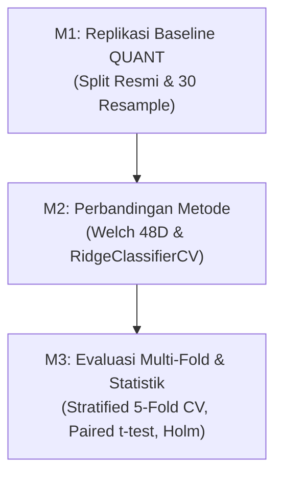

# Perbandingan QUANT dan Fitur Statistik Spektral Welch untuk Klasifikasi Sinyal Suara Mesin pada FordA

Repository ini berisi implementasi replikasi metode **QUANT** dan eksperimen perbandingan metode klasifikasi deret waktu (*time series classification*) menggunakan dataset **FordA**. Penelitian berfokus pada perbandingan representasi fitur QUANT dengan fitur statistik-spektral Welch serta perbandingan classifier ExtraTrees dan Ridge.

Eksperimen dibagi menjadi tiga tahapan utama:
- **M1**: Replikasi baseline QUANT.
- **M2**: Desain metode pembanding (fitur Welch 48D dan classifier Ridge).
- **M3**: Evaluasi multi-fold (*5-fold stratified cross-validation*) serta analisis signifikansi statistik.

---

## 1. Project Overview

Klasifikasi sinyal suara mesin merupakan salah satu permasalahan klasifikasi deret waktu. Setiap sinyal direpresentasikan sebagai rangkaian pengukuran akustik yang dapat digunakan untuk mendeteksi anomali atau membedakan dua kondisi operasional mesin.

Penelitian ini mereplikasi metode **QUANT** dari *Dempster, Schmidt, dan Webb (2024)* menggunakan dataset FordA. Selanjutnya, dilakukan dua eksperimen pembanding terarah:
1. **Perbandingan Fitur:** Mengganti representasi fitur QUANT dengan 48 fitur statistik dan spektral Welch, dengan tetap menggunakan ExtraTrees sebagai classifier.
2. **Perbandingan Classifier:** Mempertahankan fitur QUANT, tetapi mengganti ExtraTrees dengan RidgeClassifierCV.

Evaluasi dilakukan menggunakan protokol split resmi dan evaluasi lima fold untuk mengamati performa, variasi hasil antar-fold, pola kesalahan klasifikasi (*confusion matrix* dan contoh false-positive/false-negative), serta efisiensi waktu komputasi.

> [!NOTE]
> Penelitian ini merupakan studi replikasi dan perbandingan metode pada benchmark FordA, bukan pengembangan algoritma klasifikasi baru.

---

## 2. Research Objectives

Tujuan dari penelitian ini adalah:
- Mereplikasi metode QUANT pada dataset FordA berdasarkan implementasi dan konfigurasi yang dirujuk langsung dari penulis asli.
- Membandingkan efektivitas representasi fitur QUANT terhadap representasi statistik-spektral Welch 48 dimensi.
- Mengevaluasi pengaruh penggantian non-linear tree-based classifier (ExtraTrees) menjadi linear classifier (RidgeClassifierCV).
- Menganalisis performa klasifikasi secara komprehensif menggunakan metrik *Accuracy*, *Macro-F1*, *Balanced Accuracy*, dan *ROC-AUC*.
- Mengevaluasi kestabilan performa menggunakan 5-fold stratified cross-validation dan pengujian hipotesis statistik berpasangan (*paired t-test* dengan koreksi Holm).
- Mendokumentasikan konfigurasi, lingkungan komputasi (*environment*), dan log eksekusi secara transparan agar seluruh eksperimen dapat direproduksi kembali.

---

## 3. Dataset

### Karakteristik FordA
Dataset yang digunakan adalah **FordA** dari *UEA & UCR Time Series Classification Repository*.

| Karakteristik | Keterangan |
|---|---|
| **Nama Dataset** | FordA |
| **Jumlah Data Training Resmi** | 3.601 sampel |
| **Jumlah Data Testing Resmi** | 1.320 sampel |
| **Total Sampel** | 4.921 sampel |
| **Panjang Sinyal per Sampel** | 500 pengukuran |
| **Jumlah Channel** | 1 (Univariate) |
| **Jumlah Kelas** | 2 |
| **Label Kelas** | `-1` dan `+1` |

Setiap sampel merupakan satu deret waktu univariat sepanjang 500 pengukuran. Penelitian ini menggunakan data FordA tanpa mengasumsikan frekuensi sampling fisik atau durasi waktu absolut dalam detik.

- **Sumber Dataset:** [UEA & UCR Time Series Classification Repository — FordA](https://www.timeseriesclassification.com/description.php?Dataset=FordA)

> [!TIP]
> Data mentah `FordA.zip` beserta `FordA_TRAIN.ts` dan `FordA_TEST.ts` disimpan di direktori `data/data/`. Apabila dataset belum tersedia pada clone baru, unduh arsip dari tautan resmi di atas dan ekstrak ke folder tersebut.

---

## 4. Methodology

Penelitian dibagi ke dalam tiga tahapan eksperimen terstruktur:



### M1 — Replikasi Baseline QUANT
Tahap pertama mereplikasi metode QUANT pada dataset FordA sesuai protokol penulis asli.

QUANT mengekstraksi representasi interval melalui 4 representasi turunan deret waktu:
1. Sinyal asli.
2. Beda pertama yang dihaluskan (*smoothed first difference*).
3. Beda kedua (*second difference*).
4. Magnitudo Fast Fourier Transform (FFT).

Fitur dihitung melalui kuantil pada berbagai interval waktu, menghasilkan **4.469 dimensi fitur** untuk setiap sampel.

#### Konfigurasi ExtraTrees (M1)
| Parameter | Nilai |
|---|---|
| `n_estimators` | 200 |
| `criterion` | entropy |
| `max_features` | 0.1 |
| `bootstrap` | False |
| `depth` (QUANT) | 6 |
| `div` (QUANT) | 4 |

Evaluasi M1 dilakukan melalui **30 resample**. Resample ke-0 menggunakan split resmi penulis, sedangkan resample 1–29 menggunakan stratified random split dengan proporsi kelas train dan test yang identik.

---

### M2 — Perbandingan Metode
Tahap kedua membandingkan tiga metode pada split resmi FordA yang sama (3.601 train, 1.320 test):

- **Metode 1 (Baseline): QUANT + ExtraTrees**
  Menggunakan 4.469 fitur hasil transformasi QUANT dan classifier ExtraTrees 200 estimator.
- **Metode 2 (Pembanding Fitur): Statistik–Welch 48D + ExtraTrees**
  Mengganti representasi kuantil dengan 48 fitur domain waktu dan frekuensi:
  - 8 statistik bentuk sinyal (mean, std, skewness, kurtosis, peak-to-peak, RMS, crest factor, shape factor).
  - 8 statistik Power Spectral Density (PSD).
  - 32 fitur relative bandpower (estimasi PSD Welch: window Hann 256, overlap 128, FFT 256, detrend constant).
  - Classifier tetap menggunakan ExtraTrees 200 estimator (`random_state=0`).
- **Metode 3 (Pembanding Classifier): QUANT + Ridge**
  Mempertahankan 4.469 fitur QUANT, menerapkan `StandardScaler` (fit pada train fold), dan melatih `RidgeClassifierCV`.
  - Pemilihan parameter regularisasi ($\alpha$) dilakukan melalui *efficient leave-one-out CV* pada train fold dengan rentang 10 nilai logaritmik ($10^{-3}$ hingga $10^3$).

---

### M3 — Evaluasi Multi-Fold dan Analisis Statistik
Tahap ketiga mengevaluasi stabilitas ketiga metode menggunakan **5-fold Stratified Cross-Validation**.

- Seluruh 4.921 sampel FordA digabung ke dalam satu pool eksploratif dengan `StratifiedKFold(n_splits=5, shuffle=True, random_state=42)`.
- **Metrik Utama:** *Macro-F1* (ditetapkan sebelum evaluasi M3 dimulai).
- **Metrik Pendukung:** *Accuracy*, *Balanced Accuracy* (*Macro-Accuracy*), dan *ROC-AUC*.
- **Uji Signifikansi Statistik:** *Two-sided paired t-test* pada Macro-F1 antar-fold, dengan koreksi multipel *Holm* untuk 2 pembanding terhadap baseline pada tingkat signifikansi $\alpha = 0{,}05$.
- **Analisis Diagnostik:** *Learning curve* internal (4 ukuran subsampel train dengan 20% validasi internal pada fold pertama) dan audit out-of-fold error (false positive dan false negative).

> [!WARNING]
> **Catatan Protokol M3:** Hasil M3 menggunakan evaluasi cross-validation pada pool gabungan 4.921 sampel. Karena data test resmi dapat masuk ke dalam train fold M3, skor M3 tidak dapat diperlakukan sebagai evaluasi holdout eksternal yang dapat dibandingkan langsung dengan skor M1 atau M2.

---

## 5. Experimental Results

### M1 — Replikasi QUANT pada FordA
| Evaluasi | Acuan Penulis | Hasil Replikasi | Selisih ($\Delta$) |
|---|:---:|:---:|:---:|
| **Accuracy Split Asli** | 97,1212% | 96,7424% | -0,3788 pp |
| **Mean Accuracy (30 Resample)** | 96,9015% | 96,8081% | -0,0934 pp |
| **SD Accuracy (30 Resample)** | 0,5254 pp | 0,4622 pp | -0,0632 pp |

Replikasi berhasil mengonfirmasi klaim paper penulis dengan deviasi mean accuracy hanya **-0,0934 poin persentase** dari acuan resmi.

---

### M2 — Perbandingan Metode pada Split Asli
| Metode | Dimensi Fitur | Accuracy (%) | ROC-AUC |
|---|:---:|:---:|:---:|
| **QUANT + ExtraTrees (Baseline)** | 4.469 | 96,74% | 0,9958 |
| **Welch48 + ExtraTrees** | 48 | **97,35%** | **0,9966** |
| **QUANT + Ridge** | 4.469 | 95,83% | 0,9911 |

Fitur ringkas Welch 48D mampu mengungguli akurasi baseline pada split tunggal resmi, sementara reduksi dimensi mencapai **98,9%**.

---

### M3 — Evaluasi Lima Fold & Uji Signifikansi
#### Tabel Performa Rata-Rata 5-Fold
| Metode | Mean Macro-F1 (%) | SD Macro-F1 | Mean Accuracy (%) | Mean ROC-AUC | Mean Waktu Fit |
|---|:---:|:---:|:---:|:---:|:---:|
| **QUANT + ExtraTrees** | 96,79% | 0,21 pp | 96,79% | 0,9955 | 39,16 detik |
| **Welch48 + ExtraTrees** | **96,91%** | 0,64 pp | **96,91%** | **0,9956** | **0,84 detik** |
| **QUANT + Ridge** | 95,75% | 0,55 pp | 95,75% | 0,9926 | 27,80 detik |

#### Uji Hipotesis Berpasangan (*Paired t-test*, $df=4$)
| Pembanding vs Baseline | $\Delta$ Macro-F1 (pp) | Nilai $t$ | $p$-value mentah | $p$-value Holm | Signifikan ($\alpha=0{,}05$) |
|---|:---:|:---:|:---:|:---:|:---:|
| **Welch48 + ExtraTrees** | +0,1218 pp | +0,344 | 0,748050 | 0,748050 | Tidak Signifikan |
| **QUANT + Ridge** | -1,0379 pp | -3,114 | 0,035740 | 0,071481 | Tidak Signifikan |

> [!NOTE]
> Setelah koreksi Holm, kedua pembanding tidak menunjukkan perbedaan performa yang signifikan secara statistik terhadap baseline QUANT + ExtraTrees pada taraf 5%. Namun, **Welch48 + ExtraTrees menawarkan efisiensi komputasi drastis (~46x lebih cepat pada proses fit)** dengan performa yang setara.

---

## 6. Repository Structure

Struktur direktori aktual di dalam repository ini diorganisir per minggu pengerjaan dan kategori artefak:

```text
quant-forda-replication/
├── config/                               # Konfigurasi parameter & dependensi
│   ├── week1/
│   │   ├── requirements.txt
│   │   └── week1_config.json
│   ├── week2/
│   │   ├── config.json
│   │   └── requirements_actual.txt
│   └── week3/
│       ├── config.json
│       ├── requirements.txt
│       └── requirements_actual.txt
├── data/                                 # Data mentah FordA & log audit data
│   ├── data/
│   │   ├── FordA.zip
│   │   ├── FordA_TEST.ts
│   │   └── FordA_TRAIN.ts
│   ├── week2/
│   │   ├── feature_audit.json
│   │   └── split.json
│   └── week3/
│       └── data_audit.json
├── docs/                                 # Dokumentasi lingkungan & slide presentasi
│   ├── week1/
│   │   ├── environment.json
│   │   └── Minggu_1_Replikasi_QUANT_FordA.pptx
│   ├── week2/
│   │   ├── environment.json
│   │   └── Minggu_2_Pembanding_QUANT_FordA_Hasil_Colab.pptx
│   └── week3/
│       ├── environment.json
│       ├── Minggu_3_Hasil_Analisis_Colab.pptx
│       └── Panduan_M3.md
├── logs/                                 # Log terminal eksekusi per tahapan
│   ├── week1/
│   │   └── execution.log
│   ├── week2/
│   │   └── execution.log
│   └── week3/
│       └── execution.log
├── notebooks/                            # Jupyter Notebook interaktif utama
│   ├── 01_replikasi_QUANT_FordA_selesai_30_resample.ipynb
│   ├── 02_pembanding_QUANT_FordA.ipynb
│   └── 03_hasil_analisis.ipynb
├── outputs/                              # Plot visualisasi, tabel metrik, & JSON hasil
│   ├── output_week1/
│   │   ├── boxplot_resamples.png
│   │   ├── confusion_roc_original.png
│   │   ├── data_audit.json
│   │   └── paper_vs_run.csv
│   ├── output_week2/
│   │   ├── comparison.csv
│   │   ├── confusion_matrix.png
│   │   ├── learning_curves.png
│   │   ├── results.json
│   │   └── roc.png
│   └── output_week3/
│       ├── boxplot_metrics.png
│       ├── boxplot_per_class.png
│       ├── confusion_oof.png
│       ├── data_audit.json
│       ├── error_examples.png
│       ├── fold_metrics.csv
│       ├── learning_curve_internal.png
│       ├── paired_tests.csv
│       ├── results.json
│       ├── roc_multifold.png
│       ├── run_status.json
│       ├── summary.csv
│       └── uji_lokal/                    # Arsip pembanding hasil uji lokal Windows
├── .gitignore
└── readme.md
```

---

## 7. Environment and Dependencies

Seluruh eksekusi benchmark utama yang dilaporkan dijalankan pada lingkungan **Google Colab CPU** dengan spesifikasi berikut:

| Komponen | Versi / Spesifikasi |
|---|---|
| **Platform** | Google Colab (Linux x86_64) |
| **Runtime** | CPU |
| **Jumlah Thread** | 2 thread (`OMP_NUM_THREADS=2`) |
| **Python** | 3.13.18 |
| **NumPy** | 2.2.6 |
| **SciPy** | 1.15.3 |
| **scikit-learn** | 1.6.1 |
| **PyTorch** | 2.6.0+cpu |
| **Joblib** | 1.4.2 |
| **Matplotlib** | 3.10.1 |

Rincian checksum runner dan commit repositori tercatat di dalam `docs/weekX/environment.json`.

---

## 8. How to Run

Eksperimen dapat dijalankan secara interaktif menggunakan Google Colab maupun di lingkungan lokal.

### Opsi A: Menggunakan Google Colab (Direkomendasikan)
1. Unggah atau buka repository pada Google Drive / Google Colab.
2. Buka notebook sesuai tahapan eksperimen pada direktori `notebooks/`:
   - [01_replikasi_QUANT_FordA_selesai_30_resample.ipynb](file:///d:/Semester%205/PSD/Projek/quant-forda-replication/notebooks/01_replikasi_QUANT_FordA_selesai_30_resample.ipynb)
   - [02_pembanding_QUANT_FordA.ipynb](file:///d:/Semester%205/PSD/Projek/quant-forda-replication/notebooks/02_pembanding_QUANT_FordA.ipynb)
   - [03_hasil_analisis.ipynb](file:///d:/Semester%205/PSD/Projek/quant-forda-replication/notebooks/03_hasil_analisis.ipynb)
3. Pilih runtime **CPU**.
4. Jalankan cell secara berurutan (*Run All*). Setiap notebook dilengkapi script auto-download dataset dan caching fitur otomatis.

---

### Opsi B: Menggunakan Lingkungan Lokal

1. **Clone repository dan buka direktori:**
   ```bash
   git clone <url-repository>
   cd quant-forda-replication
   ```

2. **Buat dan aktifkan virtual environment:**
   - *Windows (PowerShell):*
     ```powershell
     python -m venv .venv
     .venv\Scripts\Activate.ps1
     ```
   - *Linux / macOS:*
     ```bash
     python3 -m venv .venv
     source .venv/bin/activate
     ```

3. **Pasang dependensi:**
   ```bash
   pip install -r config/week3/requirements.txt
   ```

4. **Jalankan Jupyter Notebook:**
   ```bash
   jupyter lab
   ```
   Buka notebook dari folder `notebooks/` dan jalankan cell yang diinginkan.

---

## 9. Reproducibility

Untuk memastikan seluruh angka dan hasil penelitian dapat diverifikasi secara independen:
- **Seed Terkunci:** Pengacakan fold (`split_seed=42`) dan estimator classifier (`random_state=0`) dikunci deterministik.
- **Cache Berbasis Hash:** Ekstraksi fitur QUANT menggunakan verifikasi SHA-256 untuk mendeteksi perubahan atau korupsi data.
- **Log Lengkap:** Seluruh riwayat eksekusi dan fitting disimpan dalam `logs/weekX/execution.log`.
- **Hasil Terbuka:** Tabel metrik CSV, matriks konfusi, dan kurva ROC out-of-fold disediakan secara lengkap di folder `outputs/`.

---

## 10. Limitations

1. **Cakupan Dataset:** Evaluasi hanya dilakukan pada satu dataset benchmark audio mesin (*FordA*).
2. **Keterbatasan Ukuran Fold:** Evaluasi multi-fold menggunakan 5 fold, sehingga derajat kebebasan untuk uji t-test berpasangan adalah $df=4$.
3. **Protokol Pool M3:** Evaluasi M3 menggabungkan data train dan test resmi ke dalam pool cross-validation, sehingga hasilnya tidak dapat diklaim sebagai konfirmasi validasi eksternal independen.
4. **Pengukuran Waktu:** Waktu fit classifier yang dilaporkan tidak mencakup waktu ekstraksi fitur cold-start untuk QUANT.
5. **Ketiadaan Metadata Mesin:** Tidak tersedia metadata identitas unit mesin atau sesi perekaman pada dataset FordA untuk melakukan *group cross-validation*.
6. **Generalisasi Fisik:** Label $+1$ dan $-1$ diproses secara numerik tanpa asumsi spesifik mengenai jenis kerusakan mekanikal kendaraan di lingkungan nyata.

---

## 11. References

1. A. Dempster, D. F. Schmidt, dan G. I. Webb, “QUANT: A Minimalist Interval Method for Time Series Classification,” *Data Mining and Knowledge Discovery*, vol. 38, pp. 2377–2402, 2024. [DOI: 10.1007/s10618-024-01036-9](https://doi.org/10.1007/s10618-024-01036-9)
2. UEA and UCR Time Series Classification Repository, “FordA Dataset.” [Tautan](https://www.timeseriesclassification.com/description.php?Dataset=FordA)
3. P. Geurts, D. Ernst, dan L. Wehenkel, “Extremely Randomized Trees,” *Machine Learning*, vol. 63, pp. 3–42, 2006. [DOI: 10.1007/s10994-006-6226-1](https://doi.org/10.1007/s10994-006-6226-1)
4. P. D. Welch, “The Use of Fast Fourier Transform for the Estimation of Power Spectra: A Method Based on Time Averaging over Short, Modified Periodograms,” *IEEE Transactions on Audio and Electroacoustics*, vol. 15, no. 2, pp. 70–73, 1967. [DOI: 10.1109/TAU.1967.1161901](https://doi.org/10.1109/TAU.1967.1161901)
5. A. E. Hoerl dan R. W. Kennard, “Ridge Regression: Biased Estimation for Nonorthogonal Problems,” *Technometrics*, vol. 12, no. 1, pp. 55–67, 1970. [DOI: 10.1080/00401706.1970.10488634](https://doi.org/10.1080/00401706.1970.10488634)
6. S. Holm, “A Simple Sequentially Rejective Multiple Test Procedure,” *Scandinavian Journal of Statistics*, vol. 6, no. 2, pp. 65–70, 1979. [JSTOR](https://www.jstor.org/stable/4615733)
7. scikit-learn Developers, “RidgeClassifierCV Documentation Version 1.6.1.” [Tautan](https://scikit-learn.org/1.6/modules/generated/sklearn.linear_model.RidgeClassifierCV.html)
8. SciPy Developers, “scipy.stats.ttest_rel Documentation Version 1.15.3.” [Tautan](https://docs.scipy.org/doc/scipy-1.15.3/reference/generated/scipy.stats.ttest_rel.html)

---

## 12. Project Status

| Tahapan | Deskripsi | Status |
|---|---|:---:|
| **M1** | Replikasi Baseline QUANT (30 Resample) | Selesai |
| **M2** | Eksperimen Pembanding (Welch 48D & Ridge) | Selesai |
| **M3** | Evaluasi 5-Fold CV & Uji Signifikansi Statistik | Selesai |
| **M4** | Penyusunan Draft Laporan / Artikel Ilmiah | Tersedia |
| **Dokumentasi** | Penataan Struktur & Dokumentasi README | Selesai |

> [!NOTE]
> Repository ini disusun sebagai dokumentasi penelitian akademik dan sarana reproduksi eksperimen. Hasil yang dilaporkan merupakan hasil eksperimen pada dataset FordA dan tidak dimaksudkan sebagai klaim keunggulan universal suatu metode klasifikasi.
